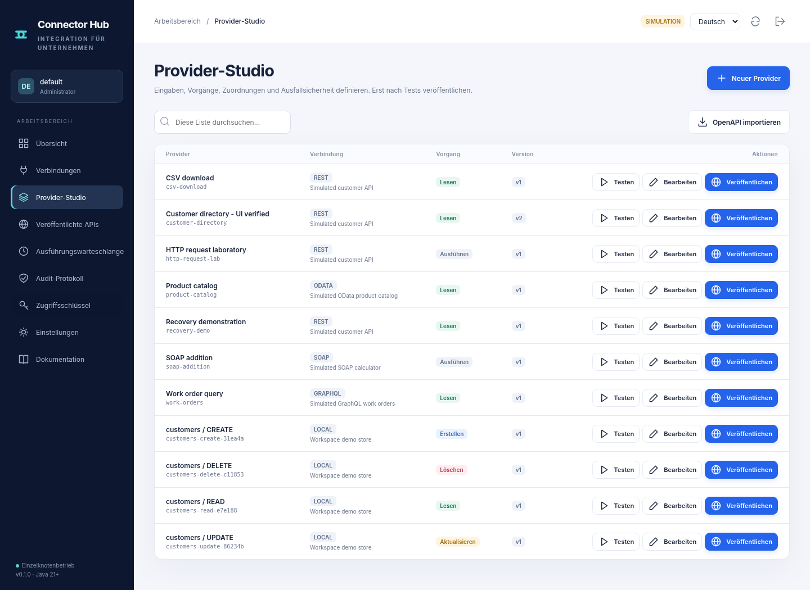

# Connector Hub

**Systeme verbinden. Wiederverwendbare APIs veröffentlichen. Wiederherstellung bewusst steuern.**

[English](README.md) · [فارسی](README.fa.md) · [Benutzerhandbuch](docs/de/user-guide.md) · [Architektur](docs/de/architecture.md) · [Prüfnachweise](docs/evidence/verification.json).

Eine selbst gehostete Java-Anwendung für konfigurierbare Datenbank- und Webservice-Provider. Verbindungen, typisierte Parameter, Operationen und Ausgabemappings werden in einer Oberfläche verwaltet und als versionierte HTTP-Endpunkte veröffentlicht. Die Oberfläche ist in Englisch, Deutsch und rechts-nach-links dargestelltem Persisch verfügbar.

**Version 0.1.0 ist eine technische Vorabversion.** Die Implementierung ist ausführbar, aber weder universell zertifiziert noch bereits verkaufs- oder produktionsreif. Die Laufzeit ist auf einen einzelnen Knoten ausgelegt. Die [Freigabekriterien](docs/de/commercial-readiness.md) beschreiben die verbleibenden Arbeiten.

.

## Demo starten

Voraussetzung ist **JDK 21 oder neuer**. Der primäre Build benötigt keine externen Java-Abhängigkeiten, kein Maven und kein Node.

```bash
bash scripts/build.sh
bash scripts/run-demo.sh
```

Unter Windows mit JDK 21 im PATH.

```powershell
.\scripts\build.ps1
.\scripts\run-demo.ps1
```

Öffnen Sie `http://127.0.0.1:8080`. Melden Sie sich mit dem bei der ersten Initialisierung im Terminal ausgegebenen Bootstrap-Token an und bewahren Sie es sicher auf. Es wird nicht erneut angezeigt. Das Datenverzeichnis ist standardmäßig `var/`. Die Demo enthält fünf Verbindungen, elf veröffentlichte Provider und fiktive Daten; ein lokaler Servicesimulator läuft auf Port 9091. Es werden keine echten Anbieter angesprochen.

```bash
java -jar build/connector-hub.jar --demo --port 18080 --data ./var-lab
```

Für zusätzliche JDBC-Treiber oder vertrauenswürdige Plugins verwenden Sie die Startskripte. Diese nehmen `drivers/*` und `plugins/*` in den Klassenpfad auf. Ohne `--demo` startet die Anwendung ohne Simulator. Die Demo darf nicht öffentlich erreichbar sein.

## Arbeitsablauf

Eine Verbindung definiert Ziel, Protokoll, Beschränkungen und verschlüsselte Zugangsdaten. Ein Provider ergänzt Operation, typisierte Eingaben, Konstanten, Systemwerte, Konfiguration oder Geheimnisse sowie Ausgabemappings. Nach einem Test wird eine unveränderliche Provider-Revision veröffentlicht. Aufrufe nutzen einen eingeschränkten Schlüssel und einen generierten Endpunkt. Entwurfsänderungen verändern veröffentlichte Revisionen nicht; Änderungen an referenzierten Verbindungen können sich jedoch auf bestehende Veröffentlichungen auswirken.

## Umfang und Prüfgrenzen

| Bereich | Implementiert | Grenze |
|---|---|---|
| LOCAL | Persistentes CRUD und Versionskonflikte. | Lokal integriert geprüft. |
| JDBC | Metadaten, parametrisiertes CRUD, SQL, Routinen und Provider-Generierung. | Zwölf echte Tests mit vorhandenem HSQLDB; andere Anbieter nicht abgenommen. |
| REST/HTTP | Methoden, JSON, Text, Formulare, Multipart und statische Authentifizierung. | Lokale HTTP-Prüfserver. |
| SOAP | 1.1/1.2, sichere XML-Verarbeitung, Fehlerantworten, begrenzte WSDL-Inspektion. | Keine vollständige WSDL-Codegenerierung oder WS-Security. |
| GraphQL/OData | Explizit konfigurierte HTTP-Operationen. | Kein vollständiger Protokollumfang. |
| Redis/MongoDB | Redis-Stringoperationen; optionaler offizieller MongoDB-Treiber. | Keine Live-Abnahme dieser Datenbanken. |
| Ausführung | Sichere Lese-Wiederholungen, Circuit Breaker, dauerhafte Idempotenz, Jobs und UNKNOWN-Klärung. | Einzelknoten; keine Exactly-once-Garantie. |
| Oberfläche | Neun Bereiche, drei Sprachen, mobiles RTL, Bearbeitung und Tests. | Browser-Harness gegen echten Server; native Navigation/CSP nicht geprüft. |

## Tests

```bash
bash scripts/test.sh
```

Die [Testdokumentation](docs/de/testing.md) erklärt Browser- und Datenbanktests. Tatsächliche XML-Berichte und Screenshots liegen unter [Prüfnachweise](docs/evidence/README.md). Es wird keine nicht gemessene Codeabdeckung behauptet. Maven, Docker, Windows, Java 25 und gehostete GitHub Actions wurden in der Erstellungsumgebung nicht ausgeführt.

Die Module `hub-core`, `hub-connectors` und `hub-server` trennen Grundlagen, Adapter und Anwendung. Die Basis verwendet Java-21/JDK-Bibliotheken, nicht Spring Boot oder Apache Camel. Zusätzliche Treiber bleiben optionale, separat lizenzierte Komponenten.

## Dokumentation

[API](docs/de/api.md) · [Konnektoren](docs/de/connectors.md) · [Sicherheit](docs/de/security.md) · [Bereitstellung](docs/de/deployment.md) · [Betrieb](docs/de/operations.md) · [Provider-Vergleich](docs/de/provider-parity.md) · [Recherche](docs/de/research.md).

Der GraphBPMS-Vergleich beschreibt unabhängig implementierte Konzepte, keine vollständige Produktparität oder Schnittstellenkompatibilität. OIDC/SSO, HA, Datenbankpools, OAuth-Token-Erneuerung, gRPC und Nachrichtenbroker fehlen in dieser Version. Vor einem produktiven oder kommerziellen Einsatz sind Sicherheitsprüfung, Anbieterabnahme, externe TLS-/Egress-Regeln, Wiederherstellungstests und ein Betriebskonzept erforderlich.

[Mitwirkung](CONTRIBUTING.de.md) · [Sicherheitsrichtlinie](SECURITY.de.md) · [Änderungsprotokoll](CHANGELOG.de.md). Der neue Quellcode wird unter der [MIT-Lizenz](LICENSE) mit Ahad Porkar als benanntem Rechteinhaber geliefert. Bitte die Lizenzentscheidung vor Veröffentlichung bestätigen. Externe Komponenten behalten ihre eigenen Lizenzen.
