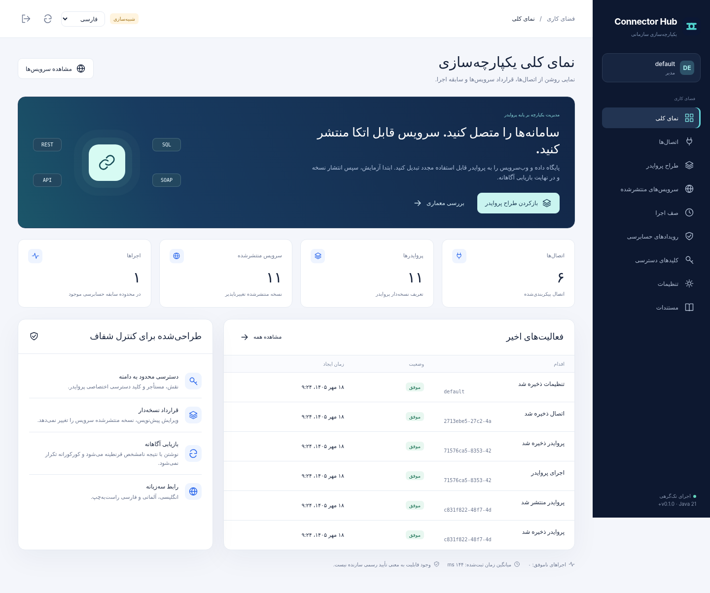

# Connector Hub

**سامانه‌ها را متصل کنید. سرویس قابل اتکا منتشر کنید. بازیابی را آگاهانه مدیریت کنید.**

[English](README.md) · [Deutsch](README.de.md) · [راهنمای کاربری](docs/fa/user-guide.md) · [معماری](docs/fa/architecture.md) · [شواهد آزمون](docs/evidence/verification.json).

یک برنامه خودمیزبان جاوا برای تعریف پروایدرهای قابل استفاده مجدد، اتصال به پایگاه داده و وب‌سرویس، تنظیم پارامترها و عملیات، آزمون قرارداد و انتشار نشانی HTTP نسخه‌دار است. رابط مدیریت به انگلیسی، آلمانی و فارسی راست‌به‌چپ ارائه شده است.

**نسخه ۰.۱.۰ یک پیش‌نمایش مهندسی است.** برنامه اجرا می‌شود، اما این موضوع به معنی آمادگی قطعی برای فروش، تأیید همه سازندگان یا پشتیبانی از تمام پروتکل‌ها نیست. اجرای فعلی تک‌گرهی است. پیش از استفاده عملیاتی، [شرایط انتشار تجاری](docs/fa/commercial-readiness.md) را بررسی کنید.

.

## اجرای نمونه

به **JDK 21 یا جدیدتر** نیاز دارید. ساخت اصلی وابستگی خارجی جاوا ندارد و به Maven یا Node نیاز ندارد.

```bash
bash scripts/build.sh
bash scripts/run-demo.sh
```

در ویندوز، پس از قرار گرفتن JDK 21 در PATH، از PowerShell استفاده کنید.

```powershell
.\scripts\build.ps1
.\scripts\run-demo.ps1
```

نشانی `http://127.0.0.1:8080` را باز کنید. توکن راه‌اندازی در اولین مقداردهی داخل ترمینال نمایش داده می‌شود؛ آن را امن نگه دارید زیرا دوباره نمایش داده نخواهد شد. داده‌ها به‌صورت پیش‌فرض در `var/` ذخیره می‌شوند. نمونه شامل پنج اتصال، یازده پروایدر منتشرشده و داده‌های ساختگی است. شبیه‌ساز سرویس روی پورت محلی 9091 اجرا می‌شود و ارتباطی با فروشندگان واقعی ندارد.

```bash
java -jar build/connector-hub.jar --demo --port 18080 --data ./var-lab
```

برای بارگذاری درایورهای سازندگان یا افزونه‌های مورد اعتماد، از اسکریپت‌های اجرا استفاده کنید تا مسیرهای `drivers/*` و `plugins/*` وارد classpath شوند. اجرای بدون `--demo` شبیه‌ساز را فعال نمی‌کند. نمونه را در اینترنت عمومی منتشر نکنید.

## روش کار پروایدر

ابتدا اتصال، مقصد مجاز و اطلاعات محرمانه رمز‌شده را تعریف کنید. سپس عملیات، ورودی‌های نوع‌دار، مقادیر ثابت، سیستمی، تنظیمات یا اسرار و نگاشت خروجی را مشخص کنید. پروایدر را با داده ساختگی آزمایش و یک نسخه منتشر کنید. برنامه مصرف‌کننده با کلید محدودشده، نشانی تولیدشده را فراخوانی می‌کند. اجرای صف، سابقه ممیزی و نتیجه نامشخص نیز قابل بررسی است.

تغییر پیش‌نویس، نسخه منتشرشده پروایدر را عوض نمی‌کند. با این حال اتصال یک منبع ارجاعی است و تغییر آن ممکن است روی نسخه منتشرشده اثر بگذارد؛ این محدودیت در مستندات روشن شده است.

## قابلیت‌ها و مرز تأیید

| بخش | پیاده‌سازی | وضعیت بررسی |
|---|---|---|
| LOCAL | CRUD پایدار، فیلتر و کنترل تعارض نسخه. | آزمون یکپارچه واقعی محلی. |
| JDBC | متادیتا، CRUD پارامتری، SQL، روال‌ها و تولید پروایدر. | دوازده آزمون واقعی با HSQLDB موجود؛ سایر سازندگان نیازمند پذیرش جداگانه‌اند. |
| REST/HTTP | روش‌های HTTP، JSON، متن، فرم، Multipart و احراز هویت ثابت. | سرویس‌های آزمایشی محلی. |
| SOAP | نسخه‌های ۱.۱ و ۱.۲، XML امن، خطا و بررسی محدود WSDL. | تولید کامل کد و WS-Security ارائه نشده است. |
| GraphQL/OData | عملیات HTTP با قرارداد صریح. | نه پوشش کامل همه امکانات استاندارد. |
| Redis/MongoDB | عملیات رشته Redis و پل درایور رسمی اختیاری MongoDB. | پذیرش روی سرور زنده انجام نشده است. |
| تاب‌آوری | تکرار امن خواندن، قطع‌کننده مدار، عدم تکرار پایدار، صف و رسیدگی UNKNOWN. | تک‌گرهی و بدون تضمین اجرای دقیقاً یک‌باره توزیع‌شده. |
| رابط | نه بخش، سه زبان، فارسی موبایل و ویرایش و اجرا. | آزمون مرورگر با واسط متصل به سرور واقعی؛ ناوبری بومی و CSP تأیید نشده‌اند. |

## آزمون و مستندات

```bash
bash scripts/test.sh
```

[راهنمای آزمون](docs/fa/testing.md) اجرای مرورگر و پذیرش پایگاه داده موقت را توضیح می‌دهد. گزارش‌های XML واقعی، تصاویر و محیط اجرا در [شواهد](docs/evidence/README.md) قرار دارند. درصد پوشش کد اندازه‌گیری نشده و ادعای آن وجود ندارد. Maven، Docker، ویندوز، Java 25 و GitHub Actions میزبانی‌شده در محیط ساخت اولیه اجرا نشده‌اند.

ماژول‌های `hub-core`، `hub-connectors` و `hub-server` به‌ترتیب هسته، اتصال‌دهنده‌ها و برنامه را جدا می‌کنند. پایه برنامه از کتابخانه‌های JDK استفاده می‌کند؛ Spring Boot و Apache Camel در این خروجی پیاده نشده‌اند. درایورهای خارجی اختیاری‌اند و مجوز جداگانه دارند.

[API](docs/fa/api.md) · [اتصال‌دهنده‌ها](docs/fa/connectors.md) · [امنیت](docs/fa/security.md) · [استقرار](docs/fa/deployment.md) · [عملیات](docs/fa/operations.md) · [مقایسه مفهومی پروایدر](docs/fa/provider-parity.md) · [پژوهش و منابع](docs/fa/research.md).

مقایسه با GraphBPMS صرفاً نگاشت مفهومی مستقل است؛ سازگاری کامل API یا برابری همه امکانات ادعا نمی‌شود. OIDC/SSO، دسترس‌پذیری بالا، استخر اتصال، نوسازی توکن OAuth، gRPC و کارگزار پیام در این نسخه موجود نیستند. استفاده تجاری به پذیرش سازندگان، آزمون امنیت، TLS و کنترل خروجی شبکه، بازیابی آزموده و مدل پشتیبانی نیاز دارد.

[مشارکت](CONTRIBUTING.fa.md) · [سیاست امنیت](SECURITY.fa.md) · [تغییرات](CHANGELOG.fa.md). کد جدید با [مجوز MIT](LICENSE) و نام Ahad Porkar ارائه شده است؛ پیش از انتشار، انتخاب مجوز و انتساب را تأیید کنید. اجزای خارجی مجوز خود را حفظ می‌کنند.
