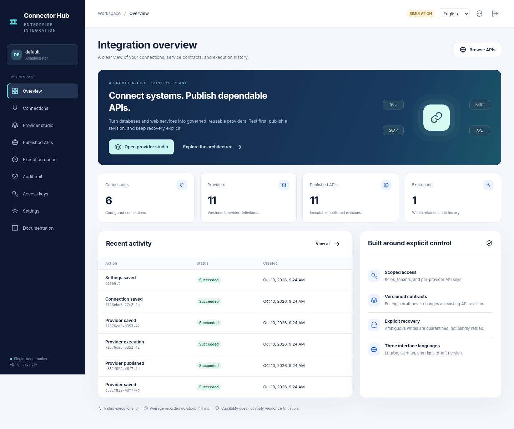

# Connector Hub

**Connect systems. Publish dependable APIs. Keep recovery explicit.**

[Deutsch](README.de.md) · [فارسی](README.fa.md) · [User guide](docs/en/user-guide.md) · [Architecture](docs/en/architecture.md) · [Verification](docs/evidence/verification.json).

A self-hosted Java application for defining reusable database and web-service providers, testing their contracts, and publishing versioned HTTP endpoints. Includes an English, German and right-to-left Persian administration interface.

**Release: v0.1.0 — engineering preview.** This is runnable implementation, not a universal connector certification or a production/sale-readiness claim. The current runtime is single-node. Review the [commercial release gates](docs/en/commercial-readiness.md) before handling production data or offering a hosted service.

.

## Start the demo

Requires **JDK 21 or newer**. The primary build has no external Java dependencies and needs neither Maven nor Node.

```bash
bash scripts/build.sh
bash scripts/run-demo.sh
```

On Windows, with JDK 21 on PATH, use PowerShell.

```powershell
.\scripts\build.ps1
.\scripts\run-demo.ps1
```

Open `http://127.0.0.1:8080` and sign in using the one-time bootstrap token printed in the terminal on first initialization. Store it securely; it is not displayed again. The default data directory is `var/`. The demo includes a separate loopback service simulator on port 9091, five connections, eleven published providers, and fictional data. It does not connect to real vendors.

Use `--port 18080 --data ./var-lab` for a separate workspace. A Java runtime can also launch the built artifact directly.

```bash
java -jar build/connector-hub.jar --demo --port 18080 --data ./var-lab
```

To load vendor drivers or trusted plugins, use `scripts/run.sh` / `scripts/run.ps1` instead of `java -jar`. They include `drivers/*` and `plugins/*` on the classpath. Non-demo startup omits `--demo`. Never expose the demo server publicly.

## Provider workflow

1. Configure a connection, destination restrictions and encrypted credentials.
2. Define a provider operation and typed parameters from input, constants, system values, tenant configuration or named secrets.
3. Configure the HTTP request, SOAP envelope, SQL or database operation, and output selection/mapping.
4. Test with synthetic input, then publish an immutable provider revision.
5. Invoke its generated endpoint with a scoped key; inspect execution, jobs, audit metadata and uncertain outcomes.

Published provider snapshots do not change when drafts are edited. Connection definitions remain referenced resources; a connection change can affect an existing publication. This boundary is documented rather than hidden behind an immutability claim.

## Implemented capabilities and evidence

| Area | Implementation | Verification boundary |
|---|---|---|
| LOCAL | Persistent CRUD, filters, version conflict checks. | Actual local integration tests. |
| JDBC | Metadata discovery, parameterized CRUD, named SQL, routines, CRUD provider generation. | Twelve real tests with the environment's legacy HSQLDB; other vendors require their own acceptance. |
| HTTP / REST | Seven HTTP methods, JSON/text/form/multipart bodies, static authentication, bounded responses. | Actual loopback HTTP fixtures. |
| SOAP | Explicit 1.1/1.2 envelopes, safe XML, faults, limited self-contained WSDL inspection. | Fixtures; not complete WSDL generation or WS-Security. |
| GraphQL / OData | HTTP operations and explicit contract configuration. | Fixtures; no subscriptions or full OData implementation. |
| Redis | Standalone RESP2 string CRUD, namespace, TTL, TLS option. | Protocol fixtures; no live Redis acceptance. |
| MongoDB | Optional official-driver bridge for bounded CRUD. | Missing-driver and validation paths; no live MongoDB acceptance. |
| API publication | Immutable revisions, scoped invocation, OpenAPI export and limited import. | Actual Java HTTP tests. |
| Resilience | Safe-read retries, circuit breaker, limits, durable idempotency, jobs, UNKNOWN reconciliation. | Fault injection and restart tests; not a distributed exactly-once guarantee. |
| Interface | Nine sections, three languages, RTL/mobile layout, editing and execution. | Playwright harness against the running server; native navigation/CSP not verified here. |

## Tests and evidence

```bash
bash scripts/test.sh
# Additional browser and disposable-database acceptance instructions:
# docs/en/testing.md
```

The archive contains actual test reports, screenshots and the environment record in [docs/evidence](docs/evidence/README.md). Tests use an offline Java runner emitting JUnit XML plus Python HTTP and Playwright suites. No line-coverage percentage or unexecuted CI badge is claimed. GitHub workflows cover the normal build, optional PostgreSQL acceptance, browser verification, and packaging; hosted workflows, Maven, Docker, Windows and Java 25 were not run in the authoring environment.

## Repository map

```text
hub-core/          JSON, typed contracts, persistence, crypto, resilience, SPI.
hub-connectors/    LOCAL, JDBC, HTTP families, Redis, MongoDB bridge.
hub-server/        HTTP API, authorization, execution, jobs, multilingual UI.
scripts/           Offline builds, tests, launchers, repository checks.
tests/             HTTP integration and browser acceptance.
examples/          Connection/provider JSON, publish script, trusted SPI plugin.
docs/en|de|fa/     Eleven technical and operational guides per language.
.github/           CI, manual vendor acceptance, packaging and issue template.
```

The baseline intentionally uses Java 21 and JDK libraries rather than pretending to include Spring Boot or Apache Camel. Both are discussed as evaluated alternatives in the research register. Extensibility does not mean every protocol is already implemented.

## Documentation

[Usage](docs/en/user-guide.md) · [API](docs/en/api.md) · [Connectors](docs/en/connectors.md) · [Security](docs/en/security.md) · [Deployment](docs/en/deployment.md) · [Operations](docs/en/operations.md) · [Testing](docs/en/testing.md) · [GraphBPMS-style provider mapping](docs/en/provider-parity.md) · [Commercial gates](docs/en/commercial-readiness.md) · [Research sources](docs/en/research.md).

The provider comparison is a clean-room concept mapping, not a claim of GraphBPMS wire compatibility, source reuse or complete feature parity.

## Before production or sale

Require native-browser and vendor acceptance, external TLS and egress controls, independent security review, identity/key-lifecycle hardening, tested backup/restore, suitable persistent storage and pooling, operational monitoring, licensing review and a support model. OIDC/SSO, HA, database pools, OAuth token refresh, gRPC, message brokers and a complete SOAP tooling stack are **not implemented** in this release. See the explicit [security limitations](docs/en/security.md).

## Publishing and contributions

Run the tests, review the evidence, select a repository name, and push this directory to your own GitHub repository. There are no claims of existing hosted CI runs, release downloads or project stars. [Contribution guide](CONTRIBUTING.md), [security policy](SECURITY.md), [changelog](CHANGELOG.md), and [third-party notices](THIRD_PARTY_NOTICES.md) are included.

The newly authored source is supplied under the [MIT License](LICENSE), with Ahad Porkar as the named copyright holder. Review and confirm that license choice before publication. Optional drivers, tools and container images keep their own licenses and are not relicensed by this repository.
