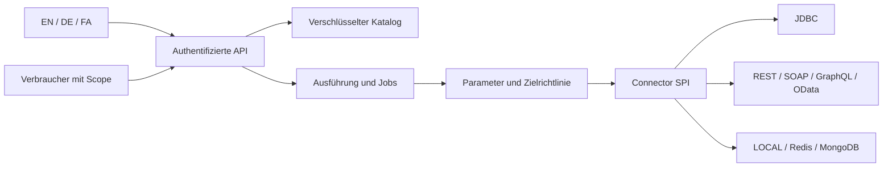

# Architektur und Entwurfsentscheidungen

[English](../en/architecture.md) · [فارسی](../fa/architecture.md).

## Module

`hub-core` enthält JSON-Modell, Parameterauflösung, SQL-Lexer, Identitäten, verschlüsselten Katalog, Ausführungsregeln und Connector-SPI. `hub-connectors` enthält LOCAL, JDBC, HTTP-Protokollfamilien, RESP2 und die optionale MongoDB-Treiberbrücke. `hub-server` übernimmt Schlüssel, Provider-Lebenszyklus, Veröffentlichungen, Jobs, Ausführung, OpenAPI und Oberfläche. Der Browser nutzt ein gleichursprüngliches ES-Modul ohne CDN oder produktive npm-Abhängigkeiten.

## Entscheidung: überprüfbarer JDK-Kern

Die Implementierung verwendet Java 21, virtuelle Threads, JDK HttpClient/HttpServer, JDBC und JAXP. In der Erstellungsumgebung konnten keine Maven-Abhängigkeiten geladen und keine Docker-Container ausgeführt werden. Deshalb wurde ein tatsächlich kompilierbarer und testbarer JDK-Kern einer ungeprüften Framework-Konfiguration vorgezogen. Das ist eine bewusste Auslieferungsentscheidung, keine allgemeine Überlegenheit selbst geschriebener Infrastruktur. Spring Boot, Spring Security, Camel, CXF und Connection Pools wurden untersucht, sind aber nicht eingebaut.

Die kanonischen Builds sind `scripts/build.sh` und `build.ps1`. Maven-Dateien dienen zusätzlich dem IDE-Import und verbundenen Builds; dieser Auflösungspfad wurde hier nicht ausgeführt. Zielversion ist Java 21. Java-25- und Windows-CI sind vorbereitet, aber lokal nicht verifiziert.

## Entscheidung: Einzelknoten-Katalog

Der Katalog ist ein verschlüsselter Snapshot, keine relationale Datenbank. Eine Prozesssperre verhindert parallele Instanzen im selben Verzeichnis. Änderungen kopieren den Zustand, verschlüsseln mit AES-256-GCM, schreiben eine temporäre Datei, erzwingen das Schreiben und ersetzen den Snapshot atomar. Verzeichnis-Fsync wird verwendet, soweit unterstützt. Lesezugriffe erhalten unabhängige Kopien.

Der Snapshot liegt im Speicher und ist auf 64 MiB begrenzt. Das erleichtert lokale Reproduzierbarkeit, unterstützt aber weder mehrere aktive Replikate noch Datenbankabfragen im großen Maßstab. Authentifizierte Verschlüsselung erkennt Manipulation/Beschädigung, nicht das Zurückspielen eines alten gültigen Snapshots. POSIX-Rechte werden gesetzt; Windows-ACLs und Netzdateisysteme benötigen eigene Prüfung. Ohne Schlüssel ist der Katalog nicht lesbar.

## Entscheidung: keine globale Exactly-once-Zusage

Vor dem Connector-Aufruf werden Berechtigungen und Parameter geprüft und ein kanonischer Fingerprint erstellt. STARTED wird dauerhaft gespeichert. Erfolg wird als DONE festgeschrieben; derselbe Schlüssel liefert das gespeicherte Ergebnis. Ein abweichender Inhalt mit demselben Schlüssel wird abgewiesen. Der Scope umfasst Mandant, Principal, Provider und Entwurfs-/Veröffentlichungsversion.

Zieltransaktion und Katalog-Commit sind nicht atomar gekoppelt. Ein Absturz dazwischen erzeugt Ungewissheit. Unterbrochene STARTED-Einträge werden UNKNOWN, nicht automatisch erneut ausgeführt. DONE und FAILED bleiben erhalten. Nach dem Löschen alter terminaler Einträge endet deren Duplikatschutz.

## Grenzen und Erweiterbarkeit

Standardmäßig sind 32 Ausführungen und 128 HTTP-Anfragen gleichzeitig zugelassen. Seiten umfassen höchstens 500 Zeilen; eingehendes JSON ist auf 1 MiB und externe HTTP-Antworten auf 2 MiB begrenzt. JDBC begrenzt serialisierte Ergebnisse, kann aber Speicherallokation innerhalb des Treibers nicht vollständig verhindern. Prozeduren liefern höchstens 20 verarbeitete Ergebnismengen. Tiefes Paging überspringt begrenzt Zeilen und ist nicht herstellerspezifisch optimiert.

Designer sind vertrauenswürdige Integrationsautoren. Gebundene Werte machen frei formuliertes SQL nicht zu einer Sandbox. Datenbankrechte, Zeilenberechtigungen und Egress-Regeln bleiben erforderlich. ServiceLoader-Plugins werden nur beim Start geladen und besitzen Prozessrechte; kein HTTP-Code-Upload ist verfügbar.

Ein Worker bearbeitet persistente Jobs. Die ursprüngliche Identität wird vor Ausführung erneut geprüft. Unterbrochene RUNNING-Jobs werden UNKNOWN; nur QUEUED kann abgebrochen werden. Für kommerzielle Skalierung sind eine transaktionale Metadatenbank, verteilte Claims, Pools, OIDC und standardisierte Telemetrie offene Architekturaufgaben.
