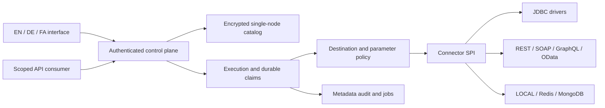

# Architecture and design decisions

[Deutsch](../de/architecture.md) · [فارسی](../fa/architecture.md).

## Module boundaries

`hub-core` contains the bounded JSON model, parameter resolution, named-SQL lexer, identities, AES-GCM catalog, retry/circuit/rate-limit primitives and Connector SPI. `hub-connectors` implements LOCAL, JDBC, HTTP families, RESP2 and the optional official MongoDB-driver bridge. `hub-server` provides configuration, key management, provider lifecycle, durable execution, jobs, generated OpenAPI, demo fixtures and the HTTP/UI layer. The browser is a same-origin ES module with no CDN or production npm dependency.

## ADR 001: verifiable JDK-only baseline

The delivered core uses Java 21, virtual threads, JDK HttpClient, JDK HttpServer, JDBC and JAXP. The authoring environment could not fetch Maven artifacts or run Docker. A JDK-only baseline was chosen so the actual source could be compiled and exercised instead of shipping unverified framework wiring. This is a delivery trade-off, not a claim that handwritten infrastructure is preferable to mature frameworks in every enterprise. Spring Boot, Spring Security, Apache Camel, CXF and established connection pools were researched but are not dependencies of this release.

The canonical build is `scripts/build.sh` or `build.ps1`. Maven descriptors are also supplied for IDE import and a connected build, but their dependency-resolution path was not executed here. Java sources target release 21. Higher JDK and Windows CI jobs are provided, not retrospectively claimed as executed.

## ADR 002: single-node catalog

The catalog is an encrypted snapshot, not an RDBMS. A process file lock prevents two instances opening the same directory. Mutations copy state, encrypt with AES-256-GCM, write a temporary file, force storage, atomically replace the snapshot and force the directory where supported. Reads return detached data. The snapshot is limited to 64 MiB and is held in memory. This favors reproducible local operation over scale. It does not support multiple replicas, rolling concurrent writers or database-grade query efficiency.

Catalog authentication detects corrupted or modified ciphertext. It does not prevent an attacker who controls storage from rolling back to a valid old snapshot. POSIX permissions are set where supported; Windows ACLs and network-storage behavior require operator verification. Losing the master key loses access to the catalog.

## ADR 003: no global exactly-once claim

Execution resolves parameters and authorization, computes a canonical request fingerprint, and durably records STARTED before invoking a connector. A successful result is committed as DONE. Reusing the same scoped key returns the committed result. A different payload with the same key is rejected. Scope includes tenant, principal, provider and publication/draft revision.

A downstream transaction and the catalog commit are not one atomic transaction. A crash between them creates uncertainty. Interrupted STARTED records become UNKNOWN, not automatically retried. DONE and FAILED records survive recovery unchanged. This provides conservative duplicate suppression inside the documented retention window, not global exactly-once processing. Pruning old terminal records ends their deduplication protection.

## ADR 004: bounded work and trusted configuration

Execution concurrency defaults to 32, HTTP request concurrency to 128, pages to 500 rows, external HTTP bodies to 2 MiB and inbound JSON to 1 MiB. JDBC row serialization has a bounded per-result budget; driver materialization can still allocate before the application sees a value. A maximum of 20 procedure result sets is consumed. Deep JDBC paging uses bounded row skipping, not vendor-optimized SQL.

Designers are trusted integration authors. Bound input values do not turn arbitrary authored SQL into a sandbox. Database privileges, row authorization, destination firewall rules and reviewed publications remain mandatory. Extension JARs are loaded through ServiceLoader at startup and execute with process privileges. They cannot be uploaded or compiled through the HTTP API.

## Jobs and evolution

One worker processes a durable queue. Queued operations retain the originating identity; a revoked or expired key blocks later execution. RUNNING jobs found at startup are quarantined as UNKNOWN. Cancellation is only for queued work. No in-flight distributed cancellation guarantee is advertised.

The next architecture step for commercial scale is a transactional metadata store, distributed claims, proper connection pooling, OIDC, standardized telemetry, contract-specific adapters and acceptance environments. These are roadmap items, not hidden implementations.
