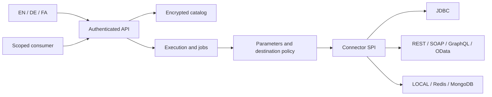

# معماری و تصمیم‌های طراحی

[English](../en/architecture.md) · [Deutsch](../de/architecture.md).

## مرزبندی ماژول‌ها

`hub-core` شامل مدل JSON محدودشده، حل پارامتر، تحلیل‌گر SQL، هویت، کاتالوگ رمز‌شده، تکرار، Circuit Breaker، محدودسازی نرخ و Connector SPI است. `hub-connectors` پیاده‌سازی LOCAL، JDBC، خانوادهٔ HTTP، RESP2 و اتصال اختیاری درایور رسمی MongoDB را دارد. `hub-server` تنظیمات، کلید، چرخهٔ پروایدر، انتشار، اجرای پایدار، صف، OpenAPI، شبیه‌ساز و رابط کاربری را ارائه می‌کند. مرورگر از ES module هم‌مبدأ و بدون CDN یا وابستگی اجرایی npm استفاده می‌کند.

## تصمیم اول: هستهٔ قابل‌آزمایش با JDK

برنامه از Java 21، Virtual Thread، HttpClient و HttpServer خود JDK، JDBC و JAXP استفاده می‌کند. در محیط ساخت امکان دریافت وابستگی Maven و اجرای Docker وجود نداشت؛ بنابراین هسته‌ای انتخاب شد که واقعاً کامپایل و اجرا شود، نه صرفاً سیم‌کشی آزمایش‌نشدهٔ فریم‌ورک‌ها. این انتخاب به معنای برتری عمومی زیرساخت دست‌نویس بر کتابخانهٔ بالغ نیست. Spring Boot، Spring Security، Camel، CXF و Connection Pool بررسی شدند ولی وابستگی این نسخه نیستند.

مسیر اصلی ساخت `scripts/build.sh` یا `build.ps1` است. فایل Maven برای IDE و ساخت در محیط متصل نیز وجود دارد، اما حل وابستگی آن در این محیط اجرا نشده است. هدف کامپایل Java 21 است. CI ویندوز و Java 25 آماده شده، ولی ادعای اجرای محلی آن‌ها وجود ندارد.

## تصمیم دوم: کاتالوگ تک‌گره

کاتالوگ یک Snapshot رمز‌شده است، نه پایگاه دادهٔ رابطه‌ای. قفل فایل مانع بازشدن هم‌زمان یک پوشه توسط دو نمونه می‌شود. تغییر، یک کپی از وضعیت می‌سازد، آن را با AES-256-GCM رمز می‌کند، در فایل موقت می‌نویسد، ذخیره‌سازی را Force می‌کند و فایل را اتمیک جایگزین می‌کند. همگام‌سازی پوشه در محیط پشتیبانی‌شده انجام می‌شود. خواندن، دادهٔ مستقل برمی‌گرداند.

Snapshot در حافظه است و سقف ۶۴ MiB دارد. این طراحی برای اجرای محلی قابل‌بازتولید است، نه چند Replica فعال یا مقیاس پایگاه داده. رمزنگاری احرازشده خرابی و دست‌کاری را تشخیص می‌دهد، نه برگرداندن Snapshot قدیمی و معتبر را. مجوز POSIX تنظیم می‌شود؛ ACL ویندوز و رفتار فایل‌سیستم شبکه باید جدا بررسی شود. گم‌شدن کلید، داده را غیرقابل‌خواندن می‌کند.

## تصمیم سوم: عدم ادعای Exactly-once سراسری

پیش از فراخوانی کانکتور، مجوز و پارامتر بررسی و Fingerprint متعارف تولید می‌شود. STARTED به‌طور پایدار ثبت می‌شود. موفقیت با DONE ذخیره می‌شود و تکرار همان کلید نتیجهٔ ثبت‌شده را می‌دهد. محتوای متفاوت با همان کلید رد می‌شود. دامنه شامل مستأجر، Principal، پروایدر و نسخهٔ پیش‌نویس یا انتشار است.

تراکنش مقصد و Commit کاتالوگ یک تراکنش اتمیک مشترک نیستند. خرابی بین این دو، ابهام ایجاد می‌کند. STARTED قطع‌شده به UNKNOWN تبدیل می‌شود و خودکار تکرار نمی‌شود. DONE و FAILED دست‌نخورده باقی می‌مانند. پاک‌کردن تاریخچهٔ نهایی، حفاظت آن کلیدها در برابر تکرار را پایان می‌دهد.

## محدودیت و توسعه

پیش‌فرض هم‌زمانی اجرا ۳۲ و HTTP برابر ۱۲۸ است. صفحه حداکثر ۵۰۰ ردیف، JSON ورودی ۱ MiB و پاسخ HTTP خارجی ۲ MiB است. خروجی JDBC محدود می‌شود، اما تخصیص حافظه در خود درایور پیش از دریافت مقدار کاملاً قابل‌کنترل نیست. حداکثر ۲۰ مجموعه‌نتیجهٔ پروسیجر پردازش می‌شود. Paging عمیق با ردکردن محدود ردیف انجام می‌شود و برای هر فروشنده بهینه‌سازی نشده است.

طراح، نویسندهٔ مورداعتماد اتصال و SQL است. Bind کردن مقدار، SQL دلخواه را به Sandbox تبدیل نمی‌کند. حداقل دسترسی پایگاه داده، محدودیت ردیف و Egress لازم است. افزونهٔ ServiceLoader فقط هنگام شروع بارگذاری می‌شود و اختیار فرایند JVM را دارد؛ آپلود یا کامپایل کد از HTTP وجود ندارد.

یک Worker صف پایدار را پردازش می‌کند. هویت اولیه پیش از اجرا دوباره بررسی می‌شود. RUNNING قطع‌شده UNKNOWN می‌شود و فقط QUEUED قابل لغو است. پایگاه دادهٔ متادیتای تراکنشی، Claim توزیع‌شده، Pool، OIDC و تله‌متری استاندارد، کارهای باز برای مقیاس تجاری هستند.
